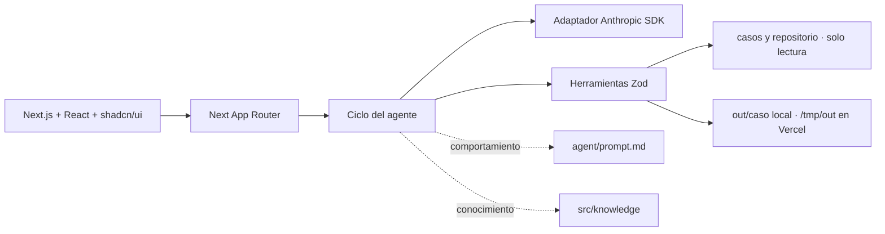

# Solución — Registro como proveedor

## Problema

La analista administrativa repite transcripciones de alto riesgo y búsqueda de soportes para registrar a Periferia como proveedor ante distintos clientes.

## Entregables del repositorio

| Entregable | Evidencia |
|---|---|
| Código TypeScript | `src/`, `app/` y `agent/`; Next.js App Router, herramientas Zod y adaptador Anthropic. |
| Demo determinista | `demo.ts`; procesa todos los casos sin LLM ni API key. |
| Documento técnico | Este archivo, `SOLUCION.md`. |
| Fixtures intactos | `casos/`, `repositorio/` y `glosario-campos.json`; no se escriben durante el flujo. |

Despliegue: [https://reto-01-registro-proveedor.vercel.app](https://reto-01-registro-proveedor.vercel.app).

## Arquitectura

Las herramientas son la frontera de confianza: recomputan y verifican el mapeo antes de escribir, validan rutas y nunca ejecutan shell ni acciones externas.

## Ciclo y límites

El servidor identifica casos de una lista local permitida. Sin clave ejecuta el mismo flujo determinista; con clave permite tool calling, con máximo de 25 llamadas y presupuesto de 40.000 tokens por sesión. Si el modelo falla o supera límites, continúa con el flujo local. La simulación queda fuera del conjunto de herramientas del modelo: solo el servidor la invoca si el turno anterior dejó `needsConfirmation` y el usuario envía el texto explícito del botón.

## Modelo y costo

El adaptador usa el SDK oficial `@anthropic-ai/sdk` y `claude-opus-5` como modelo configurable mediante `CLAUDE_MODEL`. Se eligió por su tool calling tipado y su capacidad de seguir restricciones. Sin clave el costo es cero. Con un supuesto conservador de 8.000 tokens de entrada y 2.000 de salida por caso, el costo estimado con la tarifa de USD 5/MTok de entrada y USD 25/MTok de salida es USD 0,09 por caso, antes de caché y reintentos.

## Diseño para portales

La solución actual produce `valores-portal.md` y nunca abre el portal. En producción se usaría un navegador controlado con lista de dominios, selectores versionados, capturas y pausa humana. Las credenciales vivirían en un gestor de secretos y serían ingresadas o autorizadas por la persona, nunca en el repositorio, prompt o logs. CAPTCHA, MFA y cambios de layout detienen el flujo. La persona autentica, revisa todos los valores y realiza el clic final de envío.

## Decisiones y trade-offs

1. **Herramientas deterministas sobre extracción libre del LLM.** Reduce flexibilidad ante plantillas nuevas, pero evita datos inventados y garantiza trazabilidad.
2. **Sesiones en memoria sobre base de datos.** Simplifica el reto y evita infraestructura; se pierden al reiniciar, por lo que producción requeriría persistencia cifrada.
3. **PDF generado sobre edición de AcroForm.** Funciona con fixtures sin PDF real y conserva orden; no replica el diseño visual de un formulario original.
4. **Confirmación exacta sobre inferencia semántica.** Es menos conversacional, pero elimina aprobaciones accidentales.
5. **Modo local sin clave.** Mantiene la demo operativa y predecible; las consultas abiertas tienen menor flexibilidad.

## Supuestos

- La fecha de ejecución determina la vigencia documental.
- Un NIT colombiano propuesto para RUC o RTN requiere confirmación y se deja pendiente en el formulario.
- Un campo faltante no bloquea el estado documental `listo_para_firma`; un soporte ausente o vencido sí.
- Los fixtures son inmutables y ficticios.

## Cobertura de historias

| HU | Estado | Cobertura | Pendiente de producción |
|---|---|---|---|
| Leer solicitud | Hecho | JSON y plantillas validados | Ingesta real de correo |
| Mapear campos | Hecho | Glosario, rutas y confirmaciones | Gobierno del maestro |
| Generar formulario | Hecho | XLSX, PDF y portal offline | Fidelidad a plantillas binarias reales |
| Armar paquete | Hecho | Soportes, checklist y correo | Firma e integración documental |
| Manejo de errores | Hecho | Respuestas tipadas y sesión recuperable | Observabilidad centralizada |

## Uso de IA

Se usó PERXIA como asistente de ingeniería para inspección de fixtures, implementación, revisión de contrato, UI y pruebas. Se descartó una primera propuesta que cambió firmas y nombres obligatorios; el contrato del reto se restableció antes de verificar. No se usó IA para inventar datos de negocio.

## Riesgos y mitigaciones

- **Datos maestros desactualizados:** dueño de dato, versionado y aprobación de cambios.
- **Exposición bancaria:** redacción de resúmenes, enlaces limitados y control de acceso en producción.
- **Prompt injection:** el modelo no recibe capacidad de envío y las herramientas verifican sus entradas.
- **Documentos maliciosos:** validación de tipo, tamaño, antivirus y sandbox antes de producción.
- **Concurrencia y reinicios:** persistencia transaccional, idempotencia y bloqueo distribuido.
- **Cambios regulatorios o por país:** reglas versionadas y revisión legal.
